 

---

## `[ 01 ] // BOOT SEQUENCE`

> **MISSION:** Design, develop, and evolve scalable, maintainable, and intelligent software systems.

Software engineer focused on backend development, architecture, clean code, and AI-powered solutions. I study system design, microservices, APIs, databases, cloud infrastructure, and the integration of artificial intelligence into real-world applications.

---

## `[ 02 ] // ACTIVE MODULES`

| 🔷 MODULE | ⚙️ DESCRIPTION | 📡 STATUS |
|:--|:--|:--:|
| **Backend Core** | Java, Spring Boot, REST APIs, validation and integration | 🟢 ONLINE |
| **Architecture** | Modularity, clean code and maintainability | 🟢 ONLINE |
| **Data Layer** | Data modeling, SQL, Hibernate, MongoDB | 🟢 ONLINE |
| **Salesforce** | Apex, LWC, SOQL/SOSL, Flows and integrations | 🟢 ONLINE |
| **Cloud & DevOps** | AWS, Linux, automation and deployment | 🟡 EVOLVING |
| **AI Engineering** | AI-powered apps and intelligent workflows | 🟡 EVOLVING |

---

## `[ 03 ] // PROJECT FILES`

<!-- Update the repository URL below to match your J.A.R.V.I.S. repo. -->

> **PROJECT 01 // J.A.R.V.I.S.** — A personal AI assistant I'm building from scratch. Currently in development.

---

## `[ 04 ] // TECH ARSENAL`

  

---

---

`END OF TRANSMISSION // HUDSON AMORIM`

