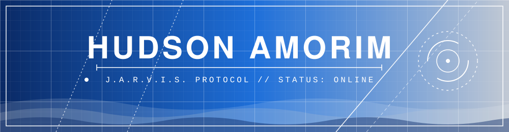

<div align="center">




<br/>

[](https://www.linkedin.com/in/hudson-amorim/)
[](https://github.com/hudson-eng-software)


</div>

---

## `[ 01 ] // BOOT SEQUENCE`

<div align="center">



</div>

> **MISSION:** Design, develop, and evolve scalable, maintainable, and intelligent software systems.

Software engineer focused on backend development, architecture, clean code, and AI-powered solutions. I study system design, microservices, APIs, databases, cloud infrastructure, and the integration of artificial intelligence into real-world applications.

---

## `[ 02 ] // ACTIVE MODULES`

<div align="center">

| 🔷 MODULE | ⚙️ DESCRIPTION | 📡 STATUS |
|:--|:--|:--:|
| **Backend Core** | Java, Spring Boot, REST APIs, validation and integration | 🟢 ONLINE |
| **Architecture** | Modularity, clean code and maintainability | 🟢 ONLINE |
| **Data Layer** | Data modeling, SQL, Hibernate, MongoDB | 🟢 ONLINE |
| **Salesforce** | Apex, LWC, SOQL/SOSL, Flows and integrations | 🟢 ONLINE |
| **Cloud & DevOps** | AWS, Linux, automation and deployment | 🟡 EVOLVING |
| **AI Engineering** | AI-powered apps and intelligent workflows | 🟡 EVOLVING |

</div>

---

## `[ 03 ] // PROJECT FILES`

<!-- Replace REPO-NAME-1..4 with your repository names. Cards update automatically. -->

<div align="center">

<a href="https://github.com/hudson-eng-software/REPO-NAME-1">
  
</a>
<a href="https://github.com/hudson-eng-software/REPO-NAME-2">
  
</a>

<a href="https://github.com/hudson-eng-software/REPO-NAME-3">
  
</a>
<a href="https://github.com/hudson-eng-software/REPO-NAME-4">
  
</a>

</div>

---

## `[ 04 ] // TECH ARSENAL`

<div align="center">


<br/><br/>


</div>

---

## `[ 05 ] // GITHUB TELEMETRY`

<div align="center">


</div>

---

## `[ 06 ] // ENGINEERING PROTOCOLS`

```text
[01]  Readability over unnecessary complexity.
[02]  Maintainability over short-term shortcuts.
[03]  Architecture driven by clear responsibilities.
[04]  Automation and repeatability wherever possible.
[05]  AI applied to solve real engineering problems.
[06]  Continuous improvement through experimentation.
```

---


## `[ 07 ] // OPEN CHANNEL`

<div align="center">


[](https://www.linkedin.com/in/hudson-amorim/)

`END OF TRANSMISSION // HUDSON AMORIM`


</div>
